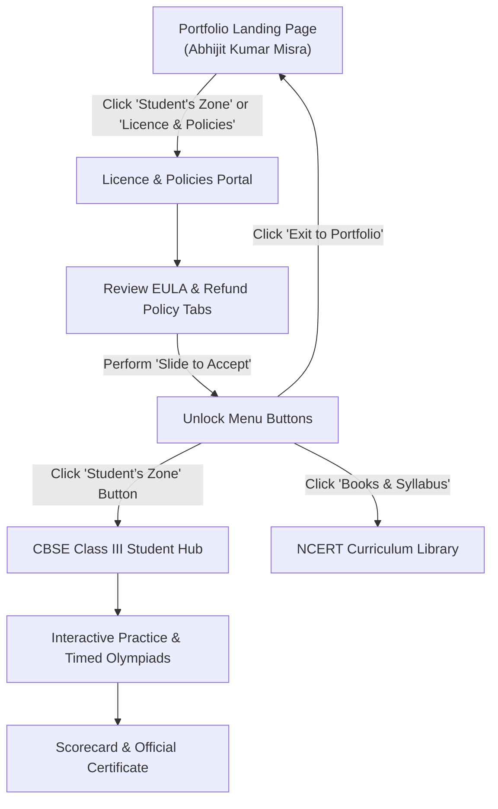

# 🏆 Talent Hunt • CBSE Class III Learning & Olympiad Platform

**Designed and Developed by:** **Abhijit Kumar Misra.**  
**Core Mission:** Empowering young learners with conceptual clarity, interactive lessons, timed Olympiad countdown challenges, and academic excellence in CBSE Class III Mathematics and English.

---

## 📌 Table of Contents
1. [Project Overview & Key Features](#-project-overview--key-features)
2. [Progress Log & Evolution](#-progress-log--evolution)
3. [User Experience Flow](#-user-experience-flow)
4. [Project Directory Structure](#-project-directory-structure)
5. [Local Development Instructions](#-local-development-instructions)
6. [Production Deployment Details](#-production-deployment-details)
7. [Security Credentials & Environment Variables](#-security-credentials--environment-variables)
8. [Database Management & Backup](#-database-management--backup)

---

## 🌟 Project Overview & Key Features

Talent Hunt is a full-stack educational web application designed for students, parents, and educators.

### 🎨 Visual & Aesthetic Design
- **Editorial Brand Identity:** Styled with Georgia serif headings, warm radial ivory gradient background (`#fffdf7`), deep navy accents (`#17477f`), and royal gold highlights (`#f2a51e`).
- **Signature Visual Accents:** Multi-layered pastel organic waves (blue, gold, teal, sage) with botanical leaf decorations.
- **Pill Navigation & Cards:** Distinctive pill action buttons with circular icon badges and gold-bordered double-frame cards.

### 📚 Academic Curriculum (CBSE Class III Focus)
- **Joyful Mathematics:** Numbers up to 9999, place value tables, addition & subtraction, geometry & symmetry, and fractional parts.
- **English Language & Literacy:** Nouns (common, proper, collective), verbs & tenses, reading comprehension, and punctuation.
- **Timed Olympiad Simulators:** 20-minute countdown test engines for IMO (International Mathematics Olympiad) and IEO (International English Olympiad).
- **Gamified Rewards:** Real-time XP tracking, honors stars, sound effects via Web Audio API, confetti celebrations, and printable gold-stamped Certificates of Academic Distinction.

---

## 📈 Progress Log & Evolution

| Phase / Milestone | Status | Key Deliverables & Enhancements |
|---|---|---|
| **Phase 1: Backend & DB** | ✅ Completed | SQLite embedded database, schema migrations, seed questions for Class III Math & English, and REST APIs for auth, content, progress, and quizzes. |
| **Phase 2: Core Platform** | ✅ Completed | SPA interactive practice engine, countdown timer, sound synthesizer, and automated certificate renderer. |
| **Phase 3: Directory Organization** | ✅ Completed | Standardized separation of file types (`/public/css`, `/public/js`, `/public/assets`, `/src/routes`, `/data`), created `.gitignore`, and moved docs into `/docs`. |
| **Phase 4: Design Imitation & EULA** | ✅ Completed | **100% imitation of Abhijit Kumar Misra's custom designs:**<br>1. Portfolio Landing Page with developer profile, photo silhouette, and custom trophy SVG brand.<br>2. End User Licence Agreement (EULA) and Refund & Cancellation Policy portal.<br>3. Interactive "Slide to Accept" slider that unlocks the menu buttons.<br>4. Segregated Student's Zone: Courseware and quizzes now open exclusively on clicking "Student’s Zone" button.<br>5. Complete aesthetic overhaul across all student pages with the new editorial theme. |

---

## 🧭 User Experience Flow



1. **Portfolio Landing Page (`#view-portfolio`):** Introduces developer Abhijit Kumar Misra, platform credentials, and primary navigation buttons.
2. **Licence & Policies Portal (`#view-licence`):** Features the gold-bordered agreement card with tabbed navigation:
   - **Tab 1: End User Licence Agreement (EULA)**: Outlines personal non-commercial license, copyright, and liability terms.
   - **Tab 2: Refund & Cancellation Policy**: Outlines transparent digital education terms, 100% free baseline tier, and 7-day money-back guarantee for premium mock series.
   - **Slide to Accept**: Interactive slider control with smooth drag physics that triggers a fanfare sound and stagger-reveals the menu buttons upon reaching 100%.
3. **Student's Zone (`#view-student-zone`):** Opens the CBSE Class III portal with quick return buttons, topic lessons, interactive quizzes, Olympiad tests, and certificate downloads.

---

## 📁 Project Directory Structure

```text
TalentHunt/
├── .env.example                     # Template for environment variables and secrets
├── .gitignore                       # Git ignore rules (node_modules, db binaries, secrets)
├── README.md                        # Master project documentation, progress, and deployment guide
├── package.json                     # Node.js project manifest & script commands
├── package-lock.json                # Pinned dependency lockfile
├── server.js                        # Express.js application entry point & static server
│
├── data/                            # Persistent Data Storage
│   └── talenthunt.db                # SQLite database (stores users, attempts, certificates)
│
├── docs/                            # Deployment & Production Guides
│   └── HOSTING_AND_DOMAIN_GUIDE.md  # Detailed instructions for Render, VPS, and DNS
│
├── public/                          # Client Static Assets (Served via Express)
│   ├── index.html                   # Master SPA shell containing all 3 views & modals
│   ├── css/                         # Stylesheets
│   │   ├── main.css                 # Base theme variables, pastel waves, landing & licence layouts
│   │   └── components.css           # Subject cards, quiz room, countdown widget, certificate modal
│   ├── js/                          # Client JavaScript Modules
│   │   ├── api.js                   # Client REST API wrapper (fetch requests)
│   │   ├── app.js                   # Main application state, slider logic, and view routing
│   │   ├── audio.js                 # Web Audio API sound synthesizer (0 external file dependencies)
│   │   ├── certificate.js           # Gold-framed certificate renderer & print utility
│   │   └── confetti.js              # Celebratory particle canvas system
│   └── assets/                      # Media & Resource Files
│       ├── images/                  # Reference screenshots and photo assets
│       └── reference/               # Original HTML & CSS design templates
│
└── src/                             # Backend Application Code
    ├── db/                          # Database Connection & Seed Data
    │   ├── database.js              # SQLite connection (using native node:sqlite) and schema
    │   └── seedData.js              # CBSE Class III syllabus, questions, and Olympiad mock exams
    ├── middleware/                  # Express Middlewares
    │   └── auth.js                  # JWT token verification middleware
    └── routes/                      # REST API Endpoints
        ├── auth.js                  # Guest login, user registration, profile updates
        ├── content.js               # CBSE Class III subjects, topics, and lessons API
        ├── progress.js              # Star tally, XP points, streaks, certificate records
        └── quiz.js                  # Practice quizzes, Olympiad countdown exams, grading
```

---

## 💻 Local Development Instructions

### 1. Prerequisites
- **Node.js:** v18.0.0 or higher (v22 LTS recommended for built-in `node:sqlite`).
- **NPM:** Installed with Node.js.

### 2. Installation
```bash
git clone https://github.com/YOUR_USERNAME/talenthunt.git
cd TalentHunt
npm install
```

### 3. Environment Configuration
Copy `.env.example` to create your local `.env`:
```bash
cp .env.example .env
```

### 4. Running the Development Server
```bash
# Starts the server with file watch mode (auto-reload on edit)
npm run dev

# Or standard production start
npm start
```

### 5. Accessing the Platform
Open your browser and navigate to:
```text
http://localhost:3000
```
- Health Check: `http://localhost:3000/api/health`

---

## 🚀 Production Deployment Details

### Option 1: 100% Free Hosting on Render (Zero-Cost Setup)
1. Push your repository to GitHub:
   ```bash
   git init
   git add .
   git commit -m "Initial commit of Talent Hunt platform"
   git remote add origin https://github.com/YOUR_USERNAME/talenthunt.git
   git push -u origin main
   ```
2. Log into [Render.com](https://render.com) and click **New +** &rarr; **Web Service**.
3. Select your GitHub repository.
4. Set the build parameters:
   - **Environment:** `Node`
   - **Build Command:** `npm install`
   - **Start Command:** `node server.js`
   - **Instance Type:** `Free`
5. Click **Create Web Service**. Your portal is live in under 2 minutes.

### Option 2: VPS Self-Hosting (Ubuntu 22.04 / 24.04 with PM2 & Nginx)
1. Install Node.js:
   ```bash
   curl -fsSL https://deb.nodesource.com/setup_22.x | sudo -E bash -
   sudo apt-get install -y nodejs nginx certbot python3-certbot-nginx
   ```
2. Clone repository & install dependencies:
   ```bash
   git clone https://github.com/YOUR_USERNAME/talenthunt.git /var/www/talenthunt
   cd /var/www/talenthunt
   npm install --production
   ```
3. Run with PM2 Process Manager:
   ```bash
   sudo npm install -g pm2
   pm2 start server.js --name "talenthunt"
   pm2 startup
   pm2 save
   ```
4. Configure Nginx Reverse Proxy (`/etc/nginx/sites-available/talenthunt`):
   ```nginx
   server {
       server_name yourdomain.com www.yourdomain.com;

       location / {
           proxy_pass http://localhost:3000;
           proxy_http_version 1.1;
           proxy_set_header Upgrade $http_upgrade;
           proxy_set_header Connection 'upgrade';
           proxy_set_header Host $host;
           proxy_cache_bypass $http_upgrade;
       }
   }
   ```
5. Enable site and provision free SSL:
   ```bash
   sudo ln -s /etc/nginx/sites-available/talenthunt /etc/nginx/sites-enabled/
   sudo nginx -t
   sudo systemctl restart nginx
   sudo certbot --nginx -d yourdomain.com -d www.yourdomain.com
   ```

### 🌐 Custom Domain DNS Setup
| Type | Name / Host | Target / Value | Description |
|---|---|---|---|
| `A` | `@` | `YOUR_SERVER_IP` | Directs root domain (e.g., `talenthunt.com`) to server |
| `CNAME` | `www` | `yourdomain.com` or `render.app` | Aliases `www` subdomain to primary address |

---

## 🔐 Security Credentials & Environment Variables

### Environment Variables Matrix (`.env`)
| Variable Name | Default Value | Description & Security Best Practice |
|---|---|---|
| `PORT` | `3000` | Port on which the Express server listens. |
| `NODE_ENV` | `production` | Set to `production` in live environments to optimize Express performance and disable verbose debug traces. |
| `JWT_SECRET` | *Random string* | **CRITICAL:** High-entropy cryptographic string used to sign student session tokens. Never commit the actual `.env` to public version control. |
| `DOMAIN` | `localhost` | Canonical domain used for CORS headers and SSL validation. |

### Generating a High-Entropy JWT Secret
Run this in terminal to generate a secure 64-character secret:
```bash
node -e "console.log(require('crypto').randomBytes(32).toString('hex'))"
```

### Security Measures Implemented
- **No Hardcoded Credentials:** All credentials and secrets are externalized via `dotenv`.
- **Protected Database Storage:** The SQLite database is located in the dedicated `/data` folder, completely isolated from publicly served assets in `/public`.
- **Git Protection:** Comprehensive `.gitignore` protects against accidental leakage of `.env`, `node_modules`, and local SQLite database binaries.
- **Client Sanitization:** Dynamic user inputs in certificates and profiles are HTML-escaped to prevent Cross-Site Scripting (XSS).
- **Graceful Rate Limiting & Auth:** Unauthenticated users can explore syllabus and practice via a guest profile; sensitive score submissions require valid session signatures.

---

## 🗄️ Database Management & Backup

- **Engine:** SQLite (using native `node:sqlite`).
- **File Location:** `./data/talenthunt.db`
- **Backup Command:** Simply copy the single `.db` file at any time to create a complete instant snapshot:
  ```bash
  cp data/talenthunt.db backups/talenthunt_backup_$(date +%F).db
  ```
- **Automatic Seeding:** The database seeds initial Class III Mathematics & English syllabi, lesson summaries, and Olympiad mock tests on the very first server launch.

---

*© 2026 Talent Hunt. Designed and Developed by Abhijit Kumar Misra. All rights reserved.*
