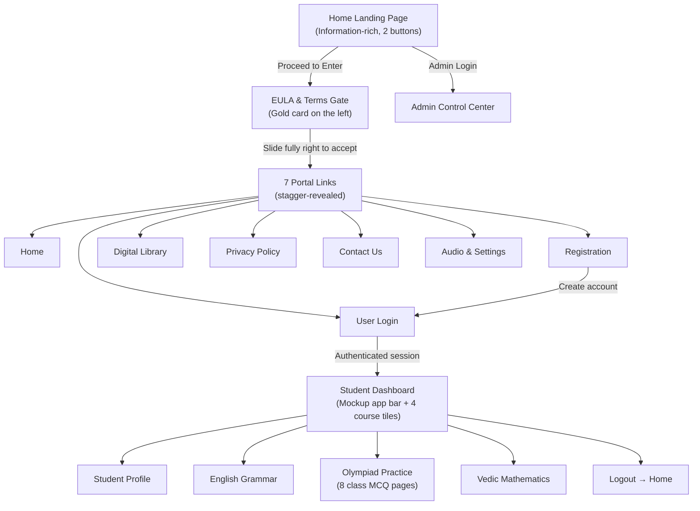

# 🏆 Talent Hunt • CBSE Class III–X Learning & Olympiad Platform

**Designed and Developed by:** **Abhijit Kumar Misra.**  
**Core Mission:** Empowering young learners with conceptual clarity, interactive lessons, timed Olympiad countdown challenges, and academic excellence across CBSE Classes III–X in Mathematics, English and Vedic Mathematics.

---

## 📌 Table of Contents
1. [Project Overview & Key Features](#-project-overview--key-features)
2. [Progress Log & Evolution](#-progress-log--evolution)
3. [User Experience Flow](#-user-experience-flow)
4. [Project Directory Structure](#-project-directory-structure)
5. [Local Development Instructions](#-local-development-instructions)
6. [Production Deployment Details](#-production-deployment-details)
7. [Security Credentials & Environment Variables](#-security-credentials--environment-variables)
8. [Database Management & Backup](#-database-management--backup)

---

## 🌟 Project Overview & Key Features

Talent Hunt is a full-stack educational web application designed for students, parents, and educators.

### 🎨 Visual & Aesthetic Design
- **Editorial Brand Identity:** Styled with Georgia serif headings, warm radial ivory gradient background (`#fffdf7`), deep navy accents (`#17477f`), and royal gold highlights (`#f2a51e`).
- **Signature Visual Accents:** Multi-layered pastel organic waves (blue, gold, teal, sage) with botanical leaf decorations.
- **Pill Navigation & Cards:** Distinctive pill action buttons with circular icon badges and gold-bordered double-frame cards.
- **Two-Button Home Gateway:** The Home page presents a single, information-rich landing experience with exactly two actions — **Proceed to Enter** and **Admin Login**.
- **Mockup Student Dashboard:** After login, students see a dark navy app bar with Home, Digital Library, Practice Portal, Contact Us, Admin and an avatar menu, followed by the kids hero banner, four course tiles and the “Learn Today… Lead Tomorrow…” footer strip.

### 📚 Academic Curriculum (CBSE Classes III–X)
- **Mathematics:** Place value, arithmetic, fractions, geometry, algebra, trigonometry, statistics and probability, mapped by class.
- **English Language & Literacy:** Grammar, parts of speech, tenses, vocabulary, comprehension, punctuation and composition.
- **Eight Class-Wise Olympiad MCQ Pages:** One dedicated 10-question, 15-minute test page for each class from III to X, with instant scoring and printable certificates.
- **Vedic Mathematics:** The 16 sutras, worked mental-calculation examples and a live speed-squaring simulator.
- **Gamified Rewards:** Real-time XP tracking, honors stars, sound effects via Web Audio API, confetti celebrations, and printable gold-stamped Certificates of Academic Distinction.

---

## 📈 Progress Log & Evolution

| Phase / Milestone | Status | Key Deliverables & Enhancements |
|---|---|---|
| **Phase 1: Backend & DB** | ✅ Completed | SQLite embedded database, schema migrations, seed questions for CBSE Class III–X, and REST APIs for auth, content, progress, and quizzes. |
| **Phase 2: Core Platform** | ✅ Completed | SPA interactive practice engine, countdown timer, sound synthesizer, and automated certificate renderer. |
| **Phase 3: Directory Organization** | ✅ Completed | Standardized separation of file types (`/public/css`, `/public/js`, `/public/assets`, `/src/routes`, `/data`), created `.gitignore`, and moved docs into `/docs`. |
| **Phase 4: Design Imitation & EULA** | ✅ Completed | **100% imitation of Abhijit Kumar Misra's custom designs:**<br>1. Portfolio Landing Page with developer profile, photo silhouette, and custom trophy SVG brand.<br>2. End User Licence Agreement (EULA) and Refund & Cancellation Policy portal.<br>3. Interactive "Slide to Accept" slider that unlocks the menu buttons.<br>4. Segregated Student's Zone: Courseware and quizzes now open exclusively on clicking "Student’s Zone" button.<br>5. Complete aesthetic overhaul across all student pages with the new editorial theme. |
| **Phase 5: Gateway, 7-Link Portal & Mockup Student Dashboard** | ✅ Completed | 1. Home reduced to exactly two entry buttons — **Proceed to Enter** and **Admin Login** — while retaining and reorganising all informational sections.<br>2. EULA slider now starts **locked** on the left; it only unlocks after a genuine left-to-right slide (clicking can no longer silently accept).<br>3. Seven colour-coded portal links appear one-by-one after acceptance: Home, Registration, User Login, Digital Library, Privacy Policy, Contact Us, Audio & Settings.<br>4. Registration now stores the student's real class (III–X), then routes to User Login.<br>5. The logged-in dashboard mirrors the approved mockup: dark navy app bar, kids hero banner, 2 × 2 course tiles (Classes, English Grammar, Olympiad Practice, Vedic Mathematics) and the footer motto. Student Profile, Analytics, Achievers, Community and Logout live in the avatar dropdown.<br>6. Dedicated Student Profile dashboard with XP, stars, streak, accuracy, academic details, recent assessments and badges.<br>7. Eight class-wise Olympiad MCQ exams (Class III–X) seeded and linked; all are 10 questions / 15 minutes / certificate-eligible.<br>8. Logout confirmation returns the learner to the Home page and relocks the EULA gate.<br>9. Fixed licence DOM nesting (the menu is now a proper right-hand column), added the missing Refund tab button, repaired Olympiad submission payloads, and fixed admin statistics. |

---

## 🧭 User Experience Flow



1. **Home (`#view-portfolio`):** A complete informational landing page with exactly two buttons:
   - **Proceed to Enter** — resets the EULA slider to locked and opens the licence gate.
   - **Admin Login** — opens the administrator sign-in screen.
2. **EULA & Terms Gate (`#view-licence`):** The gold-bordered agreement card sits on the left with two tabs:
   - **EULA & Terms** — licence grant, academic integrity, IP, liability and acceptable-use clauses.
   - **Refund & Cancellation** — the free tier, 7-day guarantee and refund procedure.
   - The slider starts at the **far left** with a "Slide right to accept" instruction. Clicking alone does nothing; the visitor must drag it to at least 90% to unlock the portal.
3. **Unlocked Portal Links:** After acceptance, seven colour-coded links appear one after another: Home, Registration, User Login, Digital Library, Privacy Policy, Contact Us, Audio & Settings.
4. **Registration → User Login:** Registration stores the learner's real class (III–X) and then returns to the User Login form with the User ID prefilled. A successful login opens the student dashboard.
5. **Student Dashboard:** Matches the approved mockup:
   - **Dark navy app bar** — Talent Hunt brand, Home, Digital Library, Practice Portal, Contact Us, Admin, and the avatar menu.
   - **Kids hero banner** — “Discover. Learn. Grow. Choose your learning adventure.”
   - **2 × 2 course tiles** — Classes / Standards (with eight class pills), English Grammar, Olympiad Practice and Vedic Mathematics.
   - **Avatar menu** — Student Profile, Edit Academic Profile, Learning Analytics, Achievers, Community Hub and Logout.
   - **Footer strip** — “Learn Today… Lead Tomorrow…”

---

## 📁 Project Directory Structure

```text
TalentHunt/
├── .env.example                     # Template for environment variables and secrets
├── .gitignore                       # Git ignore rules (node_modules, db binaries, secrets)
├── README.md                        # Master project documentation, progress, and deployment guide
├── package.json                     # Node.js project manifest & script commands
├── package-lock.json                # Pinned dependency lockfile
├── server.js                        # Express.js application entry point & static server
│
├── data/                            # Persistent Data Storage
│   └── talenthunt.db                # SQLite database (users, attempts, certificates, 8 MCQ exams)
│
├── docs/                            # Deployment & Production Guides
│   └── HOSTING_AND_DOMAIN_GUIDE.md  # Detailed instructions for Render, VPS, and DNS
│
├── public/                          # Client Static Assets (Served via Express)
│   ├── index.html                   # Master SPA shell: Home, EULA gate, portal pages & student dashboard
│   ├── css/                         # Stylesheets
│   │   ├── main.css                 # Base theme variables, pastel waves, landing & licence layouts
│   │   └── components.css           # Subject cards, quiz room, countdown widget, certificate modal
│   ├── js/                          # Client JavaScript Modules
│   │   ├── api.js                   # Client REST API wrapper (fetch requests)
│   │   ├── app.js                   # Main application state, slider logic, and view routing
│   │   ├── audio.js                 # Web Audio API sound synthesizer (0 external file dependencies)
│   │   ├── certificate.js           # Gold-framed certificate renderer & print utility
│   │   └── confetti.js              # Celebratory particle canvas system
│   └── assets/                      # Media & Resource Files
│       ├── images/                  # Reference screenshots and photo assets
│       └── reference/               # Original HTML & CSS design templates
│
└── src/                             # Backend Application Code
    ├── db/                          # Database Connection & Seed Data
    │   ├── database.js              # SQLite connection (using native node:sqlite) and schema
    │   └── seedData.js              # CBSE Class III–X content, 80 MCQ questions, and Olympiad exam seeds
    ├── middleware/                  # Express Middlewares
    │   └── auth.js                  # JWT token verification middleware
    └── routes/                      # REST API Endpoints
        ├── auth.js                  # Guest login, user registration, profile updates
        ├── content.js               # CBSE Class III–X subjects, topics, lessons and Olympiad list API
        ├── progress.js              # Star tally, XP points, streaks, certificate records
        └── quiz.js                  # Practice quizzes, Olympiad countdown exams, grading
```

---

## 💻 Local Development Instructions

### 1. Prerequisites
- **Node.js:** v18.0.0 or higher (v22 LTS recommended for built-in `node:sqlite`).
- **NPM:** Installed with Node.js.

### 2. Installation
```bash
git clone https://github.com/YOUR_USERNAME/talenthunt.git
cd TalentHunt
npm install
```

### 3. Environment Configuration
Copy `.env.example` to create your local `.env`:
```bash
cp .env.example .env
```

### 4. Running the Development Server
```bash
# Starts the server with file watch mode (auto-reload on edit)
npm run dev

# Or standard production start
npm start
```

### 5. Accessing the Platform
Open your browser and navigate to:
```text
http://localhost:3000
```
- Health Check: `http://localhost:3000/api/health`

---

## 🚀 Production Deployment Details

### Option 1: 100% Free Hosting on Render (Zero-Cost Setup)
1. Push your repository to GitHub:
   ```bash
   git init
   git add .
   git commit -m "Initial commit of Talent Hunt platform"
   git remote add origin https://github.com/YOUR_USERNAME/talenthunt.git
   git push -u origin main
   ```
2. Log into [Render.com](https://render.com) and click **New +** &rarr; **Web Service**.
3. Select your GitHub repository.
4. Set the build parameters:
   - **Environment:** `Node`
   - **Build Command:** `npm install`
   - **Start Command:** `node server.js`
   - **Instance Type:** `Free`
5. Click **Create Web Service**. Your portal is live in under 2 minutes.

### Option 2: VPS Self-Hosting (Ubuntu 22.04 / 24.04 with PM2 & Nginx)
1. Install Node.js:
   ```bash
   curl -fsSL https://deb.nodesource.com/setup_22.x | sudo -E bash -
   sudo apt-get install -y nodejs nginx certbot python3-certbot-nginx
   ```
2. Clone repository & install dependencies:
   ```bash
   git clone https://github.com/YOUR_USERNAME/talenthunt.git /var/www/talenthunt
   cd /var/www/talenthunt
   npm install --production
   ```
3. Run with PM2 Process Manager:
   ```bash
   sudo npm install -g pm2
   pm2 start server.js --name "talenthunt"
   pm2 startup
   pm2 save
   ```
4. Configure Nginx Reverse Proxy (`/etc/nginx/sites-available/talenthunt`):
   ```nginx
   server {
       server_name yourdomain.com www.yourdomain.com;

       location / {
           proxy_pass http://localhost:3000;
           proxy_http_version 1.1;
           proxy_set_header Upgrade $http_upgrade;
           proxy_set_header Connection 'upgrade';
           proxy_set_header Host $host;
           proxy_cache_bypass $http_upgrade;
       }
   }
   ```
5. Enable site and provision free SSL:
   ```bash
   sudo ln -s /etc/nginx/sites-available/talenthunt /etc/nginx/sites-enabled/
   sudo nginx -t
   sudo systemctl restart nginx
   sudo certbot --nginx -d yourdomain.com -d www.yourdomain.com
   ```

### 🌐 Custom Domain DNS Setup
| Type | Name / Host | Target / Value | Description |
|---|---|---|---|
| `A` | `@` | `YOUR_SERVER_IP` | Directs root domain (e.g., `talenthunt.com`) to server |
| `CNAME` | `www` | `yourdomain.com` or `render.app` | Aliases `www` subdomain to primary address |

---

## 🔐 Security Credentials & Environment Variables

### Environment Variables Matrix (`.env`)
| Variable Name | Default Value | Description & Security Best Practice |
|---|---|---|
| `PORT` | `3000` | Port on which the Express server listens. |
| `NODE_ENV` | `production` | Set to `production` in live environments to optimize Express performance and disable verbose debug traces. |
| `JWT_SECRET` | *Random string* | **CRITICAL:** High-entropy cryptographic string used to sign student session tokens. Never commit the actual `.env` to public version control. |
| `DOMAIN` | `localhost` | Canonical domain used for CORS headers and SSL validation. |

### Generating a High-Entropy JWT Secret
Run this in terminal to generate a secure 64-character secret:
```bash
node -e "console.log(require('crypto').randomBytes(32).toString('hex'))"
```

### Security Measures Implemented
- **No Hardcoded Credentials:** All credentials and secrets are externalized via `dotenv`.
- **Protected Database Storage:** The SQLite database is located in the dedicated `/data` folder, completely isolated from publicly served assets in `/public`.
- **Git Protection:** Comprehensive `.gitignore` protects against accidental leakage of `.env`, `node_modules`, and local SQLite database binaries.
- **Client Sanitization:** Dynamic user inputs in certificates and profiles are HTML-escaped to prevent Cross-Site Scripting (XSS).
- **Graceful Rate Limiting & Auth:** Unauthenticated users can explore syllabus and practice via a guest profile; sensitive score submissions require valid session signatures.

---

## 🗄️ Database Management & Backup

- **Engine:** SQLite (using native `node:sqlite`).
- **File Location:** `./data/talenthunt.db`
- **Backup Command:** Simply copy the single `.db` file at any time to create a complete instant snapshot:
  ```bash
  cp data/talenthunt.db backups/talenthunt_backup_$(date +%F).db
  ```
- **Automatic Seeding:** On first launch the database seeds the Class III subject/topic content and the original Class III Olympiad papers. On every launch, `ensureMcqOlympiadsSeeded()` idempotently creates/updates the **eight class-wise Olympiad MCQ papers (Class III–X)** and their 80 questions.

---

## 📱 Cross-Platform & Viewport Optimization

Talent Hunt features an adaptive layout engine designed to look optimum across all screen resolutions and legacy environments:

1. **Desktop & Standard/Low-Res Laptops (1366x768, 1920x1080 at 100%, 125%, 150% Windows Scaling):**
   - Single-screen zero-scroll lock (`100vh`/`100dvh`) for the Portfolio Landing Page and Licence Portal.
   - Proportional viewport clamping (`clamp()` using `vh` and `vw`) prevents elements from expanding beyond vertical screen boundaries.
   - Eliminates artificial "150% zoom" appearance, displaying all 3 action buttons, founder identity, and interactive slider cleanly in one balanced frame.
2. **Smartphones & Handhelds (Android, iOS / AppleOS):**
   - Natural, smooth vertical scrolling with touch-first action targets (minimum 48px to 52px height).
   - Safe area inset handling (`env(safe-area-inset-top)`, `env(safe-area-inset-bottom)`) for modern iPhone notches and gesture bars.
   - Prevents unintended iOS/Android font-inflation via `-webkit-text-size-adjust: 100%`.
3. **Small-Screen & Legacy Feature Phones (Java Phone Browsers, KaiOS, Symbian, BlackBerry, Opera Mini, UC Mini):**
   - Standard legacy mobile meta tags: `HandheldFriendly`, `MobileOptimized` (320), `viewport-fit=cover`.
   - Solid fallback background colors before CSS gradients, ensuring graceful rendering on older rendering engines (WebKit, Presto).
   - Granular breakpoints down to 360px and 260px (Nokia S30+/S40/S60, BlackBerry Curve/Bold, Symbian Belle).

---

*© 2026 Talent Hunt. Designed and Developed by Abhijit Kumar Misra. All rights reserved.*
